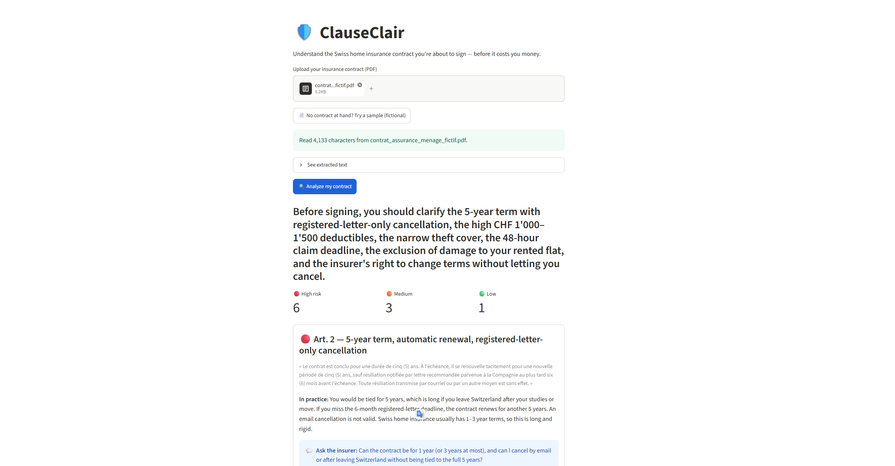

# 🛡️ ClauseClair

**ClauseClair helps international students in Switzerland understand the home insurance contract they're about to sign (in French) by flagging the clauses that could cost them money and what to ask before signing.**

🔗 **Live demo: https://clauseclair.streamlit.app**



## The problem

International students arriving in Switzerland are often asked to sign a home insurance contract (household contents + private liability) written in dense French. Deductibles, exclusions, notice periods and renewal terms are easy to miss, and they are exactly where the unexpected costs hide.

## How it works

1. **PDF → text:** the uploaded contract is read with `pypdf`.
2. **Text → Claude:** the text is sent to Claude with a *tool-use* JSON schema, so the answer comes back as structured data, not free text.
3. **JSON → cards:** each risky clause is shown as a severity card, sorted 🔴 high / 🟠 medium / 🟢 low, with:
   - the exact quote (French)
   - a plain-English explanation of what it means in practice
   - a question to ask the insurer before signing

The tone is deliberately neutral: the goal is to help you *understand* the contract, not to judge the insurer.

## Robustness

- **Not a contract:** the schema includes an `is_insurance_contract` flag; other documents get a warning instead of cards.
- **Long PDFs:** text beyond 60,000 characters is truncated, with a visible warning.
- **API errors:** a friendly message instead of a stack trace.
- **Malformed output:** if the clause list comes back as a JSON string it is parsed; if that fails, the raw text is shown rather than crashing.
- **Scanned PDFs:** if no text can be extracted, the user is told.

## Run locally

```bash
python -m venv .venv
source .venv/bin/activate        # Windows: .venv\Scripts\activate
pip install -r requirements.txt
```

Create `.streamlit/secrets.toml` (gitignored):

```toml
ANTHROPIC_API_KEY = "sk-ant-..."
```

```bash
streamlit run app.py
```

## Notes

- The sample contract in `samples/` is **fictional**, created only for testing.
- ClauseClair is an aid to understanding, **not legal advice**.
